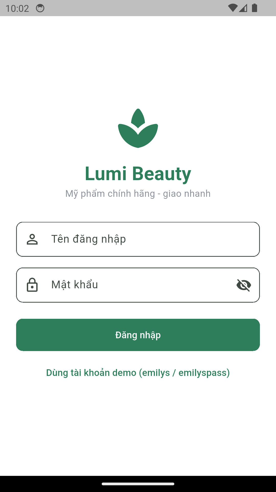
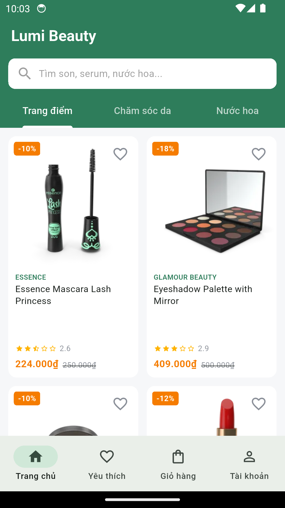
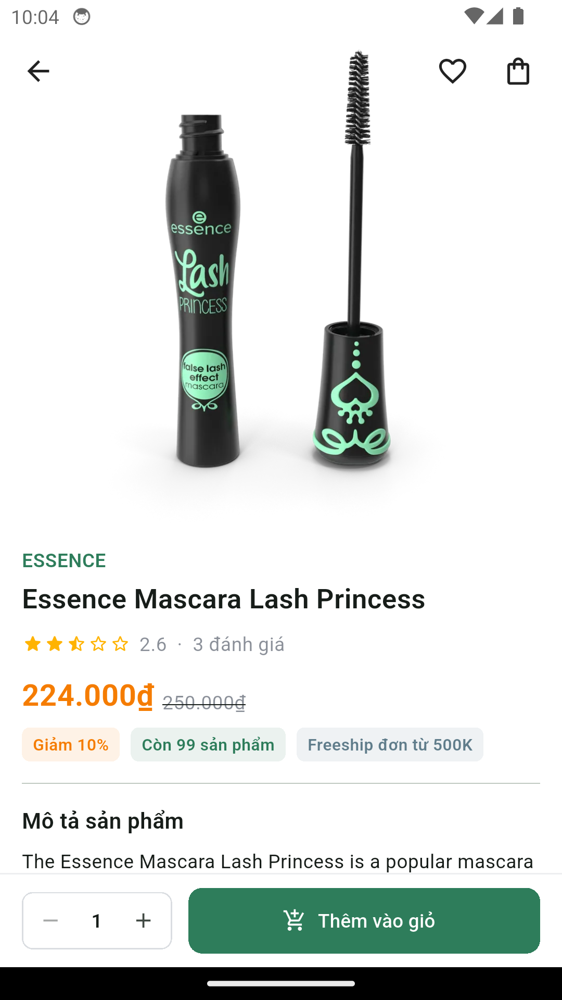
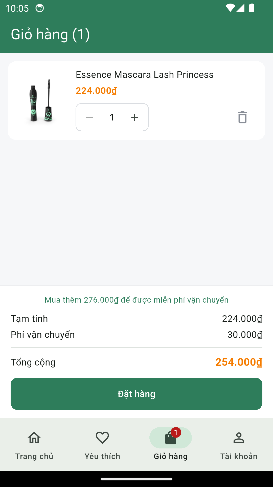

# Lumi Beauty – Flutter Cosmetics Shopping App

Ứng dụng mua sắm mỹ phẩm đa nền tảng (Android/iOS) viết bằng **Flutter & Dart**, tích hợp **RESTful API**, đăng nhập **JWT**, lưu giỏ hàng/yêu thích bằng **SQLite** và quản lý state bằng **Provider**.

> A cross-platform cosmetics e-commerce app built with Flutter: REST API integration, JWT auth, SQLite persistence, Provider state management, infinite scroll and unit/widget tests.

## Tính năng

| Màn hình | Chức năng |
|---|---|
| Đăng nhập | Form validation, JWT từ `POST /auth/login`, tự đăng nhập lại bằng token đã lưu (`GET /auth/me`) |
| Trang chủ | 3 danh mục (Trang điểm / Chăm sóc da / Nước hoa) dạng tab, **infinite scroll** phân trang `skip/limit`, pull-to-refresh |
| Tìm kiếm | Debounce 400ms, chỉ giữ sản phẩm thuộc nhóm làm đẹp, gợi ý từ khoá |
| Chi tiết | Gallery ảnh, giá sau giảm (VND), tồn kho, mô tả, tag, đánh giá của khách |
| Giỏ hàng | Thêm/sửa/xoá (vuốt để xoá), giới hạn theo tồn kho, phí ship & freeship từ 500K, đặt hàng (giả lập COD) |
| Yêu thích | Lưu offline bằng SQLite |
| Tài khoản | Thông tin user, đăng xuất |

Xử lý đủ trạng thái **loading / error (có nút thử lại) / empty** cho mọi màn hình gọi API.

## Công nghệ

- **Flutter 3 / Dart 3** (null safety, Material 3, switch expression)
- **provider** – state management + dependency injection
- **http** – gọi REST API, tự viết `ApiClient` (base URL, Bearer token, timeout, map lỗi)
- **sqflite** – SQLite cho giỏ hàng & yêu thích
- **shared_preferences** – lưu access token
- **cached_network_image** – cache ảnh
- **flutter_test** – unit test + widget test
- API: [DummyJSON](https://dummyjson.com/docs)

## Kiến trúc

```
lib/
├── core/          # ApiClient, constants, theme, formatters
├── models/        # Product, Review, User, CartItem (fromJson / toJson / toMap)
├── services/      # ProductService, AuthService  -> gọi REST API
├── data/          # AppDatabase (SQLite) + Repository (abstract + impl)
├── providers/     # AuthProvider, CartProvider, FavoriteProvider, PagedProductsProvider
├── screens/       # Các màn hình UI
└── widgets/       # Widget tái sử dụng (ProductCard, PagedProductGrid, QuantitySelector...)
test/              # Unit test model/provider + widget test
```

Luồng dữ liệu: **UI (Widget) → Provider (state) → Service / Repository → API / SQLite**.
Provider phụ thuộc vào `CartRepository` (abstract) chứ không phụ thuộc SQLite → dễ viết test với repository giả.

## Chạy project

```bash
flutter pub get
flutter run          # chạy trên máy ảo Android hoặc điện thoại thật
flutter test         # chạy toàn bộ test
flutter analyze      # kiểm tra code convention
```

Tài khoản demo: `emilys` / `emilyspass` (hoặc bấm "Dùng tài khoản demo").

## Ảnh chụp màn hình

| Đăng nhập | Trang chủ | Chi tiết | Giỏ hàng |
|---|---|---|---|
|  |  |  |  |

## Tác giả

**Huỳnh Nhật Quang** – Software Engineering, IUH · GitHub: [Quang292001](https://github.com/Quang292001)
